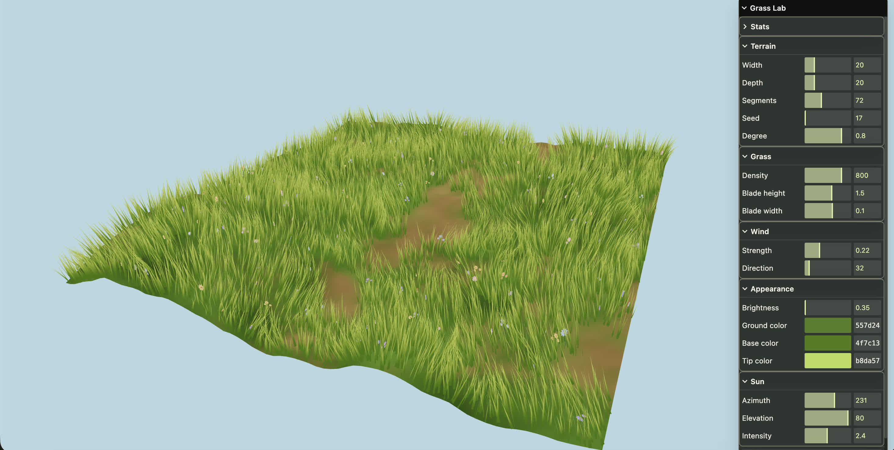

# 🌸 Meadow

> A cozy, shared 3D listening meadow for friends to listen to music, talk, and write letters together in real time.



---

## ✨ Features

- 📼 **Retro Cassette Deck**: Authentic tactile tape player with rotating spools, audio seeker, side-label volume control, and mute toggle.
- 🎶 **Multi-Link YouTube Queue**: Paste single or batch YouTube links/shorts (`https://...`), queue upcoming tracks, skip on demand, and auto-advance when tracks end.
- 🎙️ **Real-Time Voice Chat**: Multi-user WebRTC voice chat powered by LiveKit SFU with mic toggle, active speaker indicators, participant counter, and server-side room token security.
- 🎲 **Synchronized Parlor Games**: Play multiplayer parlor games directly inside the room within a non-blocking 35% floating panel, keeping the meadow, cassette music, and voice chat running uninterrupted:
  - 🐍 **Snakes and Ladders**: Authentic 100-cell checkered grid with illustrated coiled snakes, teal ladders, kinetic step-by-step hopping animations, and classic audio cues.
  - 🎲 **Ludo Classic**: Authentic 15×15 board with 4 colored home base quadrants, 4 spherical 3D goti pawns per player, central 🏆 Win House, safe star cells, 3D rolling perspective dice cube, and live emoji reaction toasts (`❤️`, `😂`, `🥺`, `💩`, `🤬`, `😭`, `😱`, `🤯`, `😎`, `🔥`).
- 💌 **Synchronized Digital Letter**: Shared interactive letter overlay that updates live across all connected peers.
- 🌾 **Stylized 3D World**: Procedural terrain, wind-reactive instanced grass blades, drifting cloud dome, and blooming wildflowers with low-angle 360° lying-down camera controls.
- 📱 **Mobile Loudspeaker Routing**: Native audio session management (`navigator.audioSession`) ensuring audio plays through full-volume stereo phone speakers instead of quiet call earpieces.
- 🔒 **Host Control & Security**: Server-side room secrets and host privilege checks ensuring only authorized participants can control playback or manage queues.
- 🔗 **Instant Room Sharing**: Unique room links (`#room=iris-XXXXXX`) for 1-click invite sharing with zero account signup required.

---

## 🚀 Quick Start

### Prerequisites

- Node.js `^20.19.0 || >=22.12.0`
- `pnpm` (or `npm` / `bun`)

### 1. Clone & Install

```bash
git clone https://github.com/rohitkhamrai/meadow.git
cd meadow
pnpm install
```

### 2. Environment Variables

Create a `.env` file in the project root:

```env
LIVEKIT_URL=wss://your-subdomain.livekit.cloud
LIVEKIT_API_KEY=your_api_key
LIVEKIT_API_SECRET=your_api_secret
```

### 3. Run Locally

```bash
pnpm dev
```

Open the printed URL (e.g., `http://localhost:5173/`). Share the `#room=...` URL with a friend to test live synchronization and voice chat.

---

## 🌐 Deploy to Vercel

Meadow includes built-in Vercel configuration ([`vercel.json`](./vercel.json)) and a serverless token endpoint ([`api/livekit-token.ts`](./api/livekit-token.ts)).

1. Push your repository to GitHub.
2. Import the project into [Vercel](https://vercel.com/new).
3. Under **Settings → Environment Variables**, add:
   - `LIVEKIT_URL`
   - `LIVEKIT_API_KEY`
   - `LIVEKIT_API_SECRET`
4. Click **Deploy**.

Every `git push` to `main` automatically triggers a zero-downtime production deployment.

---

## 🛠️ Tech Stack

- **3D World & Shaders**: WebGL & Three.js (Procedural wind-reactive grass blades, blooming wildflowers, dynamic sky dome)
- **Audio & Media**: YouTube IFrame API with custom hardware audio session management & Web Audio SFX
- **Real-Time Voice & Multiplayer Sync**: [LiveKit](https://livekit.io/) (WebRTC SFU Audio Tracks & Low-Latency DataChannels for synchronized games and letter)
- **UI Architecture**: Vanilla TypeScript & Modular CSS (Tactile retro cassette deck, 3D tumbling dice cube, responsive 35% floating parlor window)
- **Build & Quality**: [Vite](https://vitejs.dev/), TypeScript, [Vitest](https://vitest.dev/), [Oxlint](https://oxc.rs/), and [Oxfmt](https://oxc.rs/)

---

## 📜 Development Commands

| Command      | Description                                          |
| ------------ | ---------------------------------------------------- |
| `pnpm dev`   | Start local Vite development server                  |
| `pnpm build` | Type-check and compile production bundle to `dist/`  |
| `pnpm test`  | Run Vitest unit test suite                           |
| `pnpm lint`  | Run Oxlint linter                                    |
| `pnpm fmt`   | Format all source files with Oxfmt                   |
| `pnpm check` | Run lint, format check, tests, and build in sequence |

---

## 📄 License

MIT License. Designed with care for cozy shared moments.
